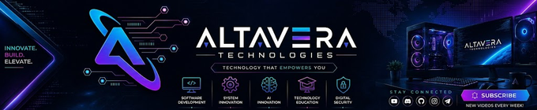

<!--
ALTAVERA TECHNOLOGIES — GITHUB PROFILE README

Before publishing:
1. Upload your banner image to this repository's root directory as `profile-banner.png`.
2. If your banner has a different filename, update the image path below.
3. Verify that each project and social link points to the correct public page.
4. Keep technology badges limited to tools you genuinely use.

This file is intentionally written in English for a professional developer profile.

  <!-- Add your existing banner to the repository root as profile-banner.png -->
  
   
  <h1>Hi, I'm Md Atikur Rahman</h1>
  <h3>Software Developer · Altavera Technologies</h3>
  

    Building mobile applications, Windows desktop software, and web platforms.
  

  

    
    
    
  

---
About Me
I'm Md Atikur Rahman, a software developer building applications and practical software tools under the Altavera Technologies brand.
My work spans different kinds of software—from mobile experiences to Windows desktop applications and web-based platforms. I use this GitHub profile to share projects, document development work, experiment with ideas, and improve software over time.
I care about building software that is useful, understandable, maintainable, and thoughtfully presented. I believe a good product is not just about making something work; it is also about creating a clear user experience, keeping the implementation organized, and making future improvements easier.
Primary focus: Application and software development
Mobile development: Flutter-based applications
Desktop development: C++ and Qt for Windows software
Web and backend: Node.js-based applications and services
Brand: Altavera Technologies
Here on GitHub: Projects, experiments, source code, and development progress
> I prefer practical solutions, clear structure, and steady improvement over unnecessary complexity.
What I Build
<table>
  <tr>
    <td width="33%" valign="top">
      <h3 align="center">📱 Mobile Applications</h3>
      
Mobile-first experiences with attention to usability, consistency, and a polished interface.

      
<strong>Core technology:</strong> Flutter

    </td>
    <td width="33%" valign="top">
      <h3 align="center">🖥️ Windows Software</h3>
      
Desktop applications and practical utilities designed for a native desktop workflow.

      
<strong>Core technologies:</strong> C++ · Qt

    </td>
    <td width="33%" valign="top">
      <h3 align="center">🌐 Web & Backend</h3>
      
Web applications, backend functionality, APIs, and supporting services.

      
<strong>Core runtime:</strong> Node.js

    </td>
  </tr>
</table>
Technology Stack
These are the main technologies represented in my current development work. This list will grow as more projects are published and documented.
Core Technologies

  
  
  
  
  

Development Areas
Area	Focus
Mobile applications	Building app experiences with Flutter
Desktop applications	Developing Windows software with C++ and Qt
Web applications	Building web-based software and user-facing experiences
Backend development	Implementing application logic and services with Node.js
Product development	Turning project ideas into structured, usable software
UI and usability	Keeping interfaces clear, consistent, and easy to understand
> **Technology note:** Badges are an overview of the technologies relevant to my work, not a claim of equal expertise in every tool. I will add more tools when they are relevant to published projects.
Selected Project
Tazkiyah Noor Demo
A Flutter-based Islamic app demo focused on useful everyday features, including Quran-related experiences, prayer times, Qibla, duas, and travel mode.
Category: Mobile application demo
Technology: Flutter
Repository: View Tazkiyah Noor Demo
This is an initial project highlight. As more repositories are ready for public presentation, this section can be updated to feature a balanced selection of mobile, desktop, and web projects.
More Projects
I plan to use this profile to present more of my software projects as they become ready to share. For the latest public repositories, visit:

  

<!--
PROJECT CARD TEMPLATE — copy this block when another project is ready to feature.

### Project Name
One or two sentences explaining what the project does and who it is for.

- **Category:** Mobile / Desktop / Web / Developer Tool
- **Technology:** Only list technologies actually used in this repository.
- **Status:** Prototype / In Progress / Released
- **Repository:** [View source](https://github.com/altaveratechnologies/REPOSITORY-NAME)
- **Demo:** Add only if a working public demo exists.

Keep only completed, meaningful, or clearly labelled in-progress projects in this section.
Engineering Principles
I aim to keep development focused on the qualities that make software useful beyond the first release.
Clarity first: Keep code, documentation, and interfaces understandable.
Useful functionality: Prioritize features that solve a real problem.
Maintainable structure: Organize projects so that future changes are easier to make.
Thoughtful user experience: Consider the user's workflow, not just the underlying implementation.
Iterative improvement: Build, test, review, and refine rather than treating the first version as the final one.
Honest documentation: Describe what a project actually does, what is incomplete, and how it can be run.
Appropriate complexity: Choose tools and patterns based on project needs rather than adding technology without a reason.
How I Approach a Project
My preferred development workflow is flexible, but the general process is:
Understand the goal — define the problem, target users, and expected outcome.
Plan the structure — identify the main components, responsibilities, and implementation approach.
Build incrementally — deliver the essential functionality before adding unnecessary extras.
Validate the result — test important user flows and correct issues as they are discovered.
Document the project — provide a useful overview, setup instructions, and relevant screenshots where appropriate.
Improve over time — refine usability, reliability, performance, and maintainability as the project evolves.
What You'll Find on This Profile
Application and software development projects
Mobile, desktop, web, and backend experiments
Source code and implementation details for public projects
Project documentation and setup instructions where applicable
Development improvements and new work as it becomes ready to share
Some repositories may be works in progress. Where relevant, I aim to make project status and limitations clear rather than presenting unfinished work as a completed release.
GitHub Overview
The cards below provide an optional, automatically generated overview of public GitHub activity. They are supplied by a third-party service and may occasionally be unavailable or rate-limited.

  
  

  Statistics reflect the data made available by GitHub and the card provider; language breakdowns are not a measure of skill level.

Connect
I'm sharing my development work and project updates through the links below. A dedicated portfolio website will be added here when it is available.

  
  
  

For now, GitHub is the main place to explore my public code and project repositories.
---

  
<strong>Altavera Technologies</strong>

  
<em>Building useful software, one project at a time.</em>

